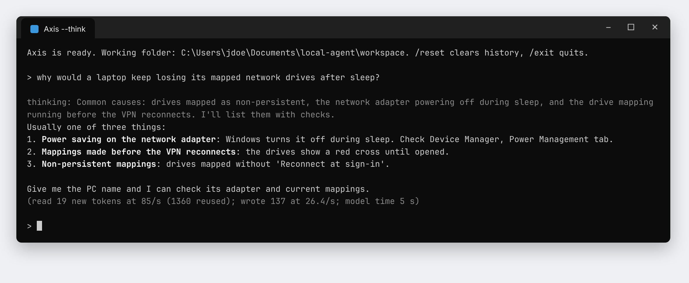

# Axis user guide

Axis is a local AI assistant for IT support. It runs an open model on your own PC through llama.cpp and talks to you in a terminal window. This guide covers installing it, choosing a model, using it day to day, and fixing common problems.

The screenshots show the real Axis interface. The PC names, people and values in them are sample data.

- [What Axis can and can't do](#what-axis-can-and-cant-do)
- [What you need](#what-you-need)
- [Install](#install)
- [Choosing a model](#choosing-a-model)
- [Everyday use](#everyday-use)
- [Your notes](#your-notes)
- [Thinking mode](#thinking-mode)
- [Options](#options)
- [Troubleshooting](#troubleshooting)
- [Updating](#updating)
- [Privacy and safety](#privacy-and-safety)

## What Axis can and can't do

**It can:**

- chat, answer questions, explain and write, like any assistant
- check this PC and other PCs by name: online status, uptime, disks, services, processes, logged-on users, event logs
- look up users, computers and groups in Active Directory (read-only)
- start and stop services, end stuck processes and restart PCs, after asking you
- read and write files in its working folder
- search your own runbooks and known fixes in the `notes` folder

**It doesn't:**

- deploy, install, uninstall or repair applications. Use Atlas for that.
- read the Atlas database. Look people and machines up in Atlas, then give Axis the PC name.
- make any change without your `y`.

## What you need

- Windows 10 or 11
- Python 3.8 or newer. Axis finds it on the PATH, in `C:\devhome\tools\python3*\current`, or in your user's Python install folder.
- RAM for the model: 64 GB for Qwen3.8-Flash-Next, 32 GB or more for the other large models, 16 GB for a 9B model
- free disk space: the model's size plus about 2 GB while its parts are joined
- optional: a graphics card with 4 GB or more of memory, which Axis uses automatically

## Install

1. **Download the agent:** [local-agent-windows.zip](https://github.com/AOSPAndroid/Axis/releases/download/local-agent-windows/local-agent-windows.zip).
2. **Download a model:** open its release page from the [table below](#choosing-a-model) and download **all** of its `.part` files into your Downloads folder. Wait until none of them ends in `.crdownload`. You don't need the other files on the page.
3. **Extract the zip:** right-click it, choose **Extract All**, and pick a folder, for example `Documents`.
4. **Start Axis:** open the `local-agent` folder and double-click **`Start Agent.bat`**.

On the first start Axis checks each model part, joins them into one file and deletes the parts. That needs about 2 GB of spare disk, and if it's interrupted, it carries on where it stopped next time. Then it starts the model and shows `Axis is ready`.


If you've downloaded more than one model, Axis asks which one to use. Press Enter for the first one.

## Choosing a model

| Key | Model | Download | Notes |
| --- | --- | --- | --- |
| `35b` | Qwen3.6-35B-A3B | [12 parts, 22.1 GB](https://github.com/AOSPAndroid/Axis/releases/tag/qwen3.6-35b-a3b-q4-k-m) | **Recommended.** Fast and good at terminal tasks. Only about 3B of its 35B parameters work on each word, so it's fast even without a graphics card. |
| `flash` | Qwen3.8-Flash-Next | [36 parts, 66.4 GB](https://github.com/AOSPAndroid/Axis/releases/tag/qwen3.8-flash-next-gsq-rco-q2-0) | The biggest and strongest: 125B parameters, 6B of them working on each word. Needs 64 GB of RAM. Its 28.8 GB word table stays on disk, so about 38 GB is held in memory. The first answer takes about a minute; later ones start in seconds. |
| `k2` | K2-Horizon-MoVA-36B-A4B | [12 parts, 22.4 GB](https://github.com/AOSPAndroid/Axis/releases/tag/k2-horizon-mova-36b-a4b-q4-k-m) | The best at terminal tasks and the least likely to make answers up. It always thinks before it answers, and you see its reasoning in grey, so answers take longer to start. About 4B of its 36B parameters work on each word. |
| `27b` | Qwen3.8-27B | [9 parts, 16.5 GB](https://github.com/AOSPAndroid/Axis/releases/tag/qwen3.8-27b-q4-k-m) | The most accurate, but slow: roughly 2 words a second on a processor, 4–6 with an 8 GB graphics card. |
| `gemma` | Gemma 4 26B-A4B | [8 parts, 14.4 GB](https://github.com/AOSPAndroid/Axis/releases/tag/gemma-4-26b-a4b-qat-q4-0) | Google's model. Fast. |
| `9b-distill` | Qwen3.8-9B distill | [4 parts, 5.8 GB](https://github.com/AOSPAndroid/Axis/releases/tag/qwen3.8-9b-q4-k-m) | Small; fits entirely on an 8 GB graphics card. Makes more mistakes. |
| `35b-abliterated` | Qwen3.6-35B-A3B abliterated | [12 parts, 21.2 GB](https://github.com/AOSPAndroid/Axis/releases/tag/qwen3.6-35b-a3b-abliterated-q4-k-m) | Community edit with refusals removed. Not recommended on work PCs. |
| `9b-abliterated` | Qwen3.5-9B abliterated | [3 parts, 5.6 GB](https://github.com/AOSPAndroid/Axis/releases/tag/qwen3.5-9b-abliterated-q4-k-m) | Same, smaller. Not recommended on work PCs. |

To skip the menu, start Axis from a terminal in the `local-agent` folder with a model key:

```
python start.py --model 35b
```

**Which model on which PC:**

- **PC without a usable graphics card:** Qwen3.6-35B-A3B. It's faster there than the 9B models, as well as smarter.
- **PC with an 8 GB graphics card:** Qwen3.6-35B-A3B for everyday use; K2-Horizon-MoVA for hard jobs.
- **PC with 64 GB of RAM and a fast SSD:** Qwen3.8-Flash-Next when you can wait a little longer for a better answer.

## Everyday use

Type a request at the `>` prompt and press Enter. Axis answers word by word as it writes. After each answer, a grey line shows how fast it worked (see [speed line](#the-speed-line)).

### Checking computers

Read-only commands run straight away and are marked *(read-only: ran without asking)*. That covers `Get-*` cmdlets, WMI and Active Directory queries, `Test-Connection`, `ipconfig /all`, `quser` and similar. Axis checks each command with PowerShell's own parser before running it.


### Making changes

Anything that changes something asks first, with the exact command in yellow: `Allow run: ... [y/N]`. Type `y` to run it or press Enter to refuse. That covers starting or stopping services, ending processes, restarting PCs, writing files and running scripts.

Axis follows the same routine for every fix: it reads the current state, says what it will change and why, asks you, then reads the state again to confirm the result.


Good to know:

- Axis restarts PCs with `Restart-Computer -ComputerName PC -Force`.
- A non-zero exit code or return value is reported as a failure, with the code.
- Axis is told never to stop the services Windows and remote management depend on (RpcSs, DcomLaunch, RpcEptMapper, Winmgmt, WinRM, LanmanServer, EventLog) or end core Windows processes. That's an instruction to the model, not a hard block, but you'd still be asked first: refuse if it ever proposes one.

### Commands

| Command | What it does |
| --- | --- |
| `/reset` | Starts a fresh conversation. |
| `/exit` | Quits Axis and stops the model. You can also close the window. |

### The speed line

```
(read 100 new tokens at 85/s (5948 reused); wrote 195 at 26.4/s; model time 9 s)
```

- **read:** how much new text the model had to read, and how fast. "Reused" text was already read and costs nothing.
- **wrote:** how much the model wrote, and how fast. Above about 15 per second feels instant.
- **model time:** the total time the model spent on your request.

## Your notes

Put your runbooks, procedures, known fixes and environment facts in the `notes` folder inside `local-agent`, as `.md` or `.txt` files. Axis sees the list of files, searches them before guessing names, paths or procedures, and tells you which note an answer came from.


- **`notes\ALWAYS.md`** is read at the start of every conversation. Keep it short: naming conventions, which server does what, when to escalate.
- **One file per topic** works best, for example `printers.md`, `outlook-profile-reset.md`, `vpn.md`.
- `notes\EXAMPLE.md` shows the format. Updating Axis only ever replaces that file, never your own notes.

Keep notes to procedures and environment facts, not staff or directory data.

## Thinking mode

For tricky problems, start Axis with thinking on. The model then reasons before it answers, and you see its reasoning in grey:

```
"Start Agent.bat" --think
```



It's slower, so it's off by default.

**K2-Horizon-MoVA always thinks.** Axis turns thinking on for it automatically and shows the reasoning in grey before each answer, so you can follow what it's checking and why. It also gets a larger context (16384) so the reasoning fits.

## Options

Add options after `"Start Agent.bat"` or `python start.py` in a terminal opened in the `local-agent` folder.

| Option | What it does |
| --- | --- |
| `--model KEY` | Use this model without asking (see [model keys](#choosing-a-model)). |
| `--think` | Turn on reasoning, shown in grey. Slower. |
| `--cpu` | Use only the processor, even if a graphics card is found. |
| `--gpu` | Try the graphics card even if it reports less than 4 GB. |
| `--ctx 4096` | Use a smaller context to save memory. The default is 8192, or 16384 for K2-Horizon-MoVA. |
| `--workdir FOLDER` | The folder Axis may read and write files in. Default: `workspace` next to `start.py`. |
| `--notes FOLDER` | Use a different notes folder. |
| `--yes` | Approve every change without asking. Not recommended on work PCs. |

## Troubleshooting

| Problem | What to do |
| --- | --- |
| "Python was not found" | Run `start.py` with the full path to `python.exe`, for example `C:\devhome\tools\python3.12\current\python.exe start.py`. |
| "The system cannot find the path specified" at the start | Fixed in the current version: update Axis. It came from the launcher's Python check and was harmless. |
| "The model is not ready yet" | One or more parts are missing or still downloading. Axis lists them. Download them and start again. |
| It stops while loading the model | Look at `server.log` in the `local-agent` folder. For memory errors, try `--ctx 4096`, or a smaller model. |
| Answers are slow | Check the speed line. If "wrote" is under about 8 per second, use Qwen3.6-35B-A3B. On a PC with a weak graphics card, compare with `--cpu`. |
| The answer is wrong or made up | Ask it to check with a command, add the facts to your notes, or use K2-Horizon-MoVA or `--think` for hard questions. |
| "The reply was cut off" | The model's reasoning filled the context. Type `/reset`, or start Axis with a larger `--ctx`, for example `--ctx 32768`. |

## Updating

Download [local-agent-windows.zip](https://github.com/AOSPAndroid/Axis/releases/download/local-agent-windows/local-agent-windows.zip) again and extract it over your `local-agent` folder, replacing files when asked. Your models, notes and working folder are kept.

## Privacy and safety

- The model runs on your PC. Your questions and the command output stay on your PC.
- Axis only changes something after you type `y`. Its file tools only work inside its working folder, but its commands run with your Windows account's rights: read-only commands can read anything you can, and changes reach anything you can change. Read each change before approving it.
- Run Axis under the same account you'd use to do the work by hand.
