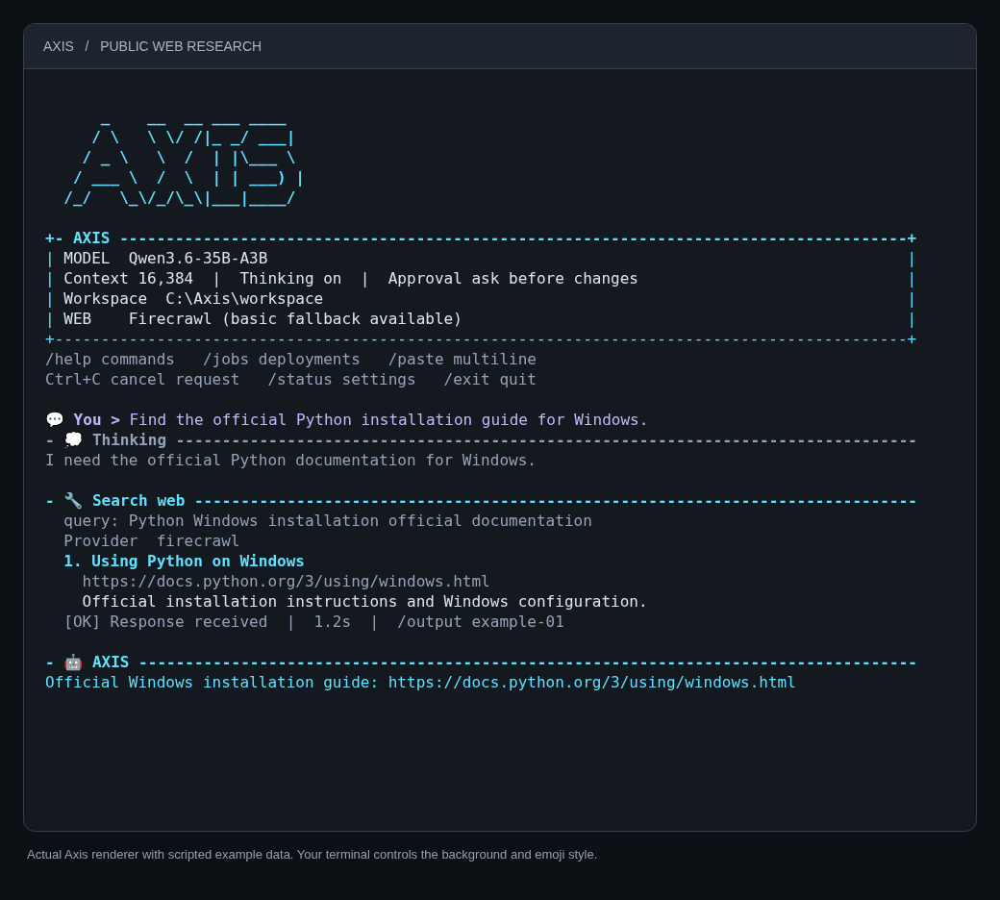
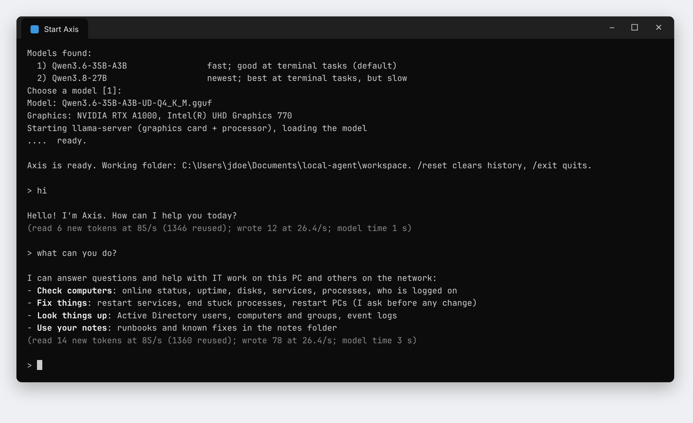
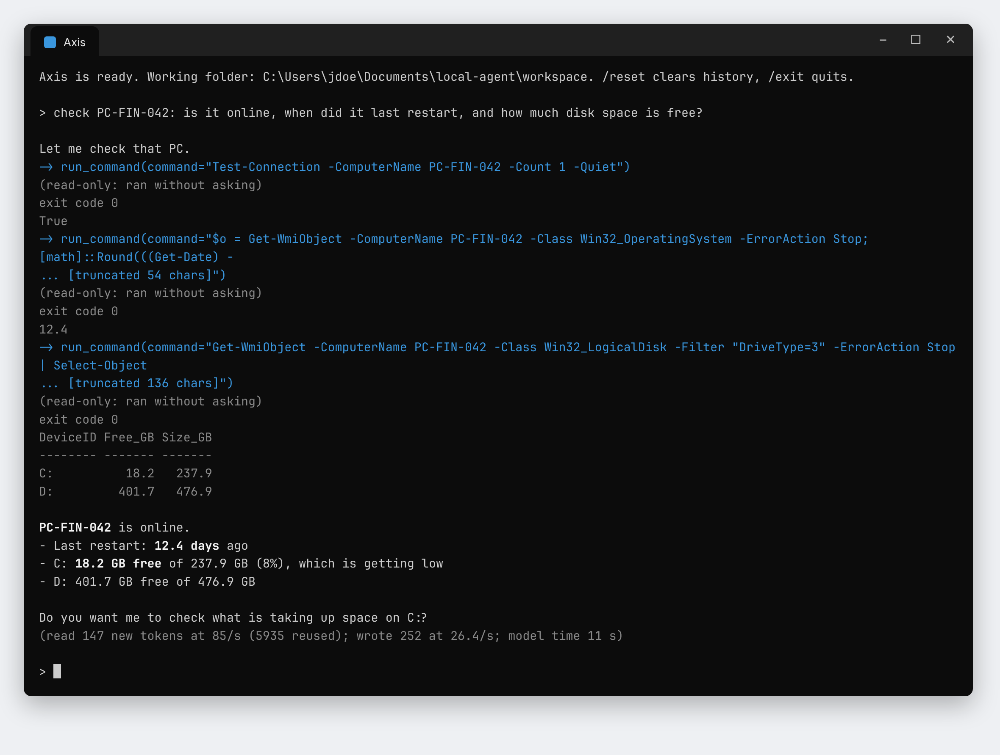
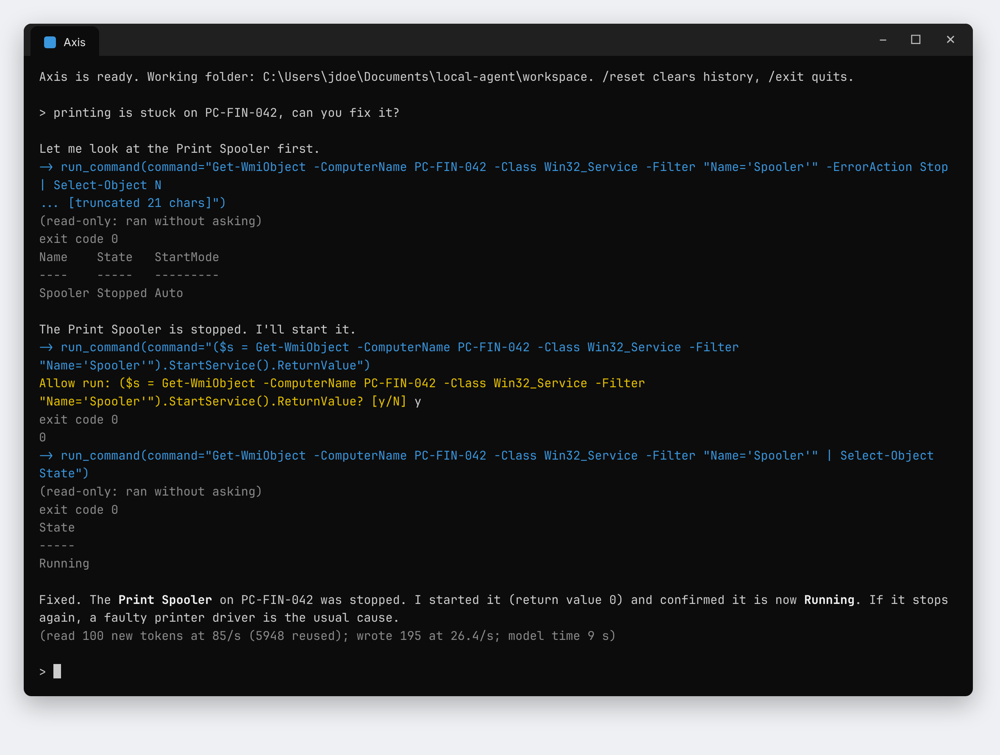
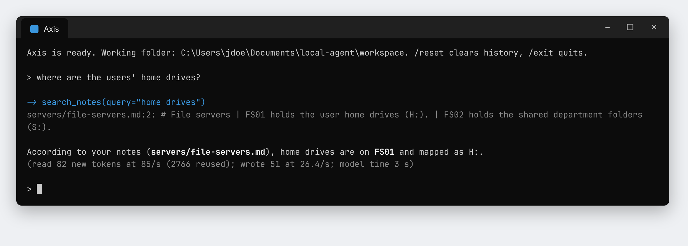

# Axis user guide

Axis is a local AI assistant for IT support. It runs an open model on your own PC through llama.cpp and talks to you in a terminal window. This guide covers installing it, choosing a model, using it day to day, and fixing common problems.

The workflow screenshots use scripted model replies and sample PC names, people and values. This preview shows the current ASCII interface using the actual renderer and scripted web results; later workflow images show an earlier console.



The startup logo reveals briefly, and a small ASCII spinner rotates while the model loads or a request runs. Animations stop before input and approval prompts. Your questions are purple, Axis's answers cyan and thinking grey, with small role icons in interactive UTF-8 terminals. Thinking and answers are displayed separately in short batches, with labelled tool results kept in normal scrollback. Loading indicators show elapsed time; deployment panels show recorded events and refresh with `/jobs ID`. Colours and emoji appearance follow your terminal capabilities, font and background theme.

On Windows, use Windows Terminal to see the role icons. For a compact display, launch `Start Agent.bat --plain`. This disables the logo, colour, icons and motion in startup and chat. `NO_COLOR`, `TERM=dumb` and redirected output also disable colour, icons and motion; legacy encodings omit icons. Text labels remain in every mode. The interface adds no third-party Python dependencies.

- [What Axis can and can't do](#what-axis-can-and-cant-do)
- [What you need](#what-you-need)
- [Install](#install)
- [Choosing a model](#choosing-a-model)
- [Everyday use](#everyday-use)
- [Package deployments](#package-deployments)
- [Public web research](#public-web-research)
- [Your notes](#your-notes)
- [Thinking mode](#thinking-mode)
- [Options](#options)
- [Troubleshooting](#troubleshooting)
- [Updating](#updating)
- [Privacy and safety](#privacy-and-safety)

## What Axis can and can't do

**It can:**

- chat, answer questions, explain and write, like any assistant
- check this PC and other PCs by name: online status, uptime, disks, services, processes, logged-on users, event logs
- look up users, computers and groups in Active Directory (read-only)
- start and stop services, end stuck processes and restart PCs, after asking you
- find packages and install, uninstall, repair or copy them to selected PCs, with persistent jobs and logs
- search the public web, read pages and follow source links
- read and write files in its working folder
- search your own runbooks and known fixes in the `notes` folder

**It doesn't:**

- need Atlas installed or running, or read the Atlas database. Give Axis an explicit PC name or ask for an Active Directory lookup.
- treat an installer's exit code as proof the application works. Application health needs a separate check.
- sign into websites or submit forms; JavaScript pages and PDFs require Firecrawl.

Changes ask for approval by default. `--yes` automatically approves actions for that session.

## What you need

- Windows 10 or 11
- Python 3.8 or newer. Axis first checks the standard installation at `C:\devhome\tools\python3.12\current\python.exe`. If absent, it checks the Python launcher, PATH, other `C:\devhome\tools\python3*\current` folders and your user's Python install folder. No PATH change is needed for the standard installation.
- RAM for the model: 32 GB or more for the large models, 16 GB for a 9B model
- free disk space: the model's size plus about 2 GB while its parts are joined
- optional: a graphics card with 4 GB or more of memory, which Axis uses automatically

## Install

1. **Download the agent:** [local-agent-windows.zip](https://github.com/AOSPAndroid/Axis/releases/download/local-agent-windows/local-agent-windows.zip).
2. **Extract the zip:** right-click it, choose **Extract All**, and pick a folder, for example `Documents`.
3. **Add your model:** copy your full `Qwen3.6-35B-A3B-UD-Q4_K_M.gguf` into the extracted `local-agent` folder beside `Start Agent.bat`. If you need a model, open its release page from the [table below](#choosing-a-model) and download **all** of its `.part` files into Downloads. Wait until none ends in `.crdownload`.
4. **Start Axis:** open the `local-agent` folder and double-click **`Start Agent.bat`**.

When a full supported GGUF is present, Axis uses it directly. For model parts, it checks and joins them, deleting consumed parts; allow about 2 GB of spare disk. An interrupted join resumes next time. Then it starts the model and shows the AXIS banner and `You >` prompt.



If you've downloaded more than one model, Axis asks which one to use. Press Enter for the first one.

## Choosing a model

| Key | Model | Download | Notes |
| --- | --- | --- | --- |
| `35b` | Qwen3.6-35B-A3B | [12 parts, 22.1 GB](https://github.com/AOSPAndroid/Axis/releases/tag/qwen3.6-35b-a3b-q4-k-m) | **Recommended starting point.** About 3B parameters are active per token; all weights still need memory. |
| `flash` | Qwen3.8-Flash-Next | [36 parts, 66.4 GB](https://github.com/AOSPAndroid/Axis/releases/tag/qwen3.8-flash-next-gsq-rco-q2-0) | Two GGUF files. Uses memory mapping and on-demand reads for a large table; RAM use and speed depend on context, offload and SSD performance. |
| `k2` | K2-Horizon-MoVA-36B-A4B | [12 parts, 22.4 GB](https://github.com/AOSPAndroid/Axis/releases/tag/k2-horizon-mova-36b-a4b-q4-k-m) | An alternative reasoning model; the launcher applies its sampling defaults. |
| `27b` | Qwen3.8-27B | [9 parts, 16.5 GB](https://github.com/AOSPAndroid/Axis/releases/tag/qwen3.8-27b-q4-k-m) | A dense model to compare on harder tasks. Speed depends on hardware and offload. |
| `gemma` | Gemma 4 26B-A4B | [8 parts, 14.4 GB](https://github.com/AOSPAndroid/Axis/releases/tag/gemma-4-26b-a4b-qat-q4-0) | An alternative from Google. |
| `9b-distill` | Qwen3.8-9B distill | [4 parts, 5.8 GB](https://github.com/AOSPAndroid/Axis/releases/tag/qwen3.8-9b-q4-k-m) | A smaller community distillation. GPU fit also depends on context and runtime overhead. |
| `35b-abliterated` | Qwen3.6-35B-A3B abliterated | [12 parts, 21.2 GB](https://github.com/AOSPAndroid/Axis/releases/tag/qwen3.6-35b-a3b-abliterated-q4-k-m) | Community edit with refusals removed. Not recommended on work PCs. |
| `flash-abliterated` | Qwen3.8-Flash-Next abliterated | [21 parts, 38.0 GB](https://github.com/AOSPAndroid/Axis/releases/tag/qwen3.8-flash-next-gsq-rco-abliterated-q2-0) | Flash-Next with refusals removed, same speed. Uses the second file from Qwen3.8-Flash-Next, so download that model's 16 `-00002-of-00002` parts too if you don't have it. Not recommended on work PCs. |
| `9b-abliterated` | Qwen3.5-9B abliterated | [3 parts, 5.6 GB](https://github.com/AOSPAndroid/Axis/releases/tag/qwen3.5-9b-abliterated-q4-k-m) | Same, smaller. Not recommended on work PCs. |

To skip the menu, start Axis from a terminal in the `local-agent` folder with a model key:

```
python start.py --model 35b
```

For **Qwen3.8-Flash-Next**, download all 36 parts and use `python start.py --model flash`, or select it from the model menu. The launcher joins the parts into two GGUF files and keeps them together. If you already have both full files, place them together in `local-agent`. The 66.4 GB download is substantially larger than Qwen3.6-35B-A3B; memory mapping reduces how much must remain resident, but does not guarantee fit or speed on a 64 GB PC.

**Which model on which PC:**

- **PC without a usable graphics card:** start with Qwen3.6-35B-A3B if RAM permits, and compare speed on your actual tasks.
- **PC with an 8 GB graphics card:** Qwen3.6-35B-A3B uses RAM plus partial GPU offload. Compare the smaller 9B distillation if you prefer more of the model on the GPU.

## Everyday use

Type a request at the `You >` prompt and press Enter. Axis streams its answer beneath an AXIS heading. The banner shows the model, context, approval/thinking settings, workspace and package repository. After each answer, a grey line shows how fast it worked (see [speed line](#the-speed-line)).

### Checking computers

Structured inspection and directory tools run without approval and show compact results. Eligible read-only shell commands also run automatically; Axis checks shell commands with PowerShell's parser. Use `/output` to read the full saved result when the console shows a summary.



### Making changes

By default, changes show an `APPROVAL REQUIRED` panel with the action and targets. Type `y` at `Allow this action? [y/N]` to run it or press Enter to refuse. That covers deployments, starting or stopping services, ending processes, restarting PCs, writing files and running scripts. `--yes` automatically approves these actions.

Axis follows the same routine for every fix: it reads the current state, says what it will change and why, asks you, then reads the state again to confirm the result.



Good to know:

- Structured reboot actions create a monitored job. Axis reports the queued job ID and returns to chat unless you asked it to wait or verify; `/jobs ID` reports progress and boot-time verification. Queued does not mean the reboot has completed.
- Deployment results distinguish script exit 0, restart-required codes 3010/1641, failures and unknown outcomes. Script completion does not verify application health.
- Structured service/process tools enforce protected targets and recheck identity against a recent inspection. General shell commands run with your Windows account's rights.
- Ctrl+C cancels the current chat request. Accepted background deployment/reboot jobs continue; inspect their status before retrying an uncertain operation.

Axis reuses repeated note/package lookups within a request and stops a continuing identical lookup loop. It still checks live machine state and job progress. Declining an action prevents the same approval prompt appearing again in that request. A new request starts fresh.

### Commands

| Command | What it does |
| --- | --- |
| `/help` | Lists commands. |
| `/status` | Shows model, workspace and session settings. |
| `/jobs [ID]` | Checks deployment/reboot progress without using the model. |
| `/output [ID] [offset]` | Reads full saved tool output in pages. |
| `/history` | Shows recent requests from this session. |
| `/paste` | Enters multiple lines; a single `.` line submits them. |
| `/clear` | Redraws the AXIS banner. |
| `/reset` | Starts a fresh conversation; background jobs continue. |
| `/exit` | Quits Axis. The launcher stops a model server it started; accepted background IT jobs continue. |

### The speed line

```
(read 100 new tokens at 85/s (5948 reused); wrote 195 at 26.4/s; model time 9 s)
```

- **read:** how many new tokens the model processed, and how fast. "Reused" tokens came from its prompt cache. Tokens are pieces of text, not necessarily whole words.
- **wrote:** how much the model wrote, and how fast. Above about 15 per second feels instant.
- **model time:** the total time the model spent on your request.

## Package deployments

Axis discovers packages from the preconfigured repository and performs install, uninstall, repair, copy-only or execute-existing workflows. Atlas is not required. `/status` shows the repository; `--package-repo PATH` overrides it.

Ask Axis to find the package, then give it the exact target PC names and desired action. It shows an approval before starting. An accepted job ID means queued; `/jobs` tracks each target and `/output` exposes full logs and results. Jobs persist in the `state` folder next to the agent.

If monitoring is lost, the result is `unknown`. Inspect the target and logs before retrying. A successful installer exit still needs an application or vendor-specific health check.

## Public web research

Ask for a public search or provide a URL, for example: `Search Microsoft's documentation for installer exit code 3010 and cite it.` Axis can read result pages, follow their links and continue long pages in sections. `/output` shows the full returned tool result.

For better web research, double-click **Configure Firecrawl.bat**, paste your API key at the hidden prompt, and restart Axis. The key stays in `%LOCALAPPDATA%\Axis\firecrawl.key`, so updating the ZIP preserves it. Alternatively set `FIRECRAWL_API_KEY` in your environment. `/status` shows whether Firecrawl is configured.

Firecrawl provides search, JavaScript page rendering and public PDF extraction. It receives queries and requested URLs and uses your API credits; PDF extraction is billed per page. If it is unavailable, Axis displays a notice and uses the basic HTML/text reader. Pagination of a cached page does not repeat the API request.

Basic browsing works without an API key and supports public HTML/text only. Neither provider signs into websites, submits forms or uploads local files. Keep queries generic and leave internal names, credentials and private file content out. `--no-web` disables both providers.

## Your notes

Put your runbooks, procedures, known fixes and environment facts in the `notes` folder inside `local-agent`, as `.md` or `.txt` files. Axis sees the list of files, searches them before guessing names, paths or procedures, and tells you which note an answer came from.



- **`notes\ALWAYS.md`** is read at the start of every conversation. Keep it short: naming conventions, which server does what, when to escalate.
- **One file per topic** works best, for example `printers.md`, `outlook-profile-reset.md`, `vpn.md`.
- `notes\EXAMPLE.md` shows the format. Updating Axis only ever replaces that file, never your own notes.

Keep notes to procedures and environment facts, not staff or directory data.

## Thinking mode

Thinking is enabled and displayed by default. Double-click `Start Agent.bat` normally: the model’s thinking appears under a Thinking heading, followed by its answer. A small spinner shows activity while waiting for output. Tool results are expanded by default. Use `--compact` for shorter summaries; thinking remains visible.

For faster answers without thinking, run:

```
"Start Agent.bat" --no-think
```

Thinking can delay the final answer. If you are reusing a server started with thinking disabled, restart it with the new settings.

## Options

Add options after `"Start Agent.bat"` or `python start.py` in a terminal opened in the `local-agent` folder.

| Option | What it does |
| --- | --- |
| `--model KEY` | Use this model without asking (see [model keys](#choosing-a-model)). |
| `--think` | Enable and display model reasoning. This is the default. |
| `--no-think` | Disable thinking for faster answers. |
| `--verbose` | Expand returned tool results (default); thinking is already displayed. |
| `--compact` | Use shorter tool summaries; thinking remains visible. |
| `--plain` | Use compact headings without the logo, colour or animation in startup and chat. `NO_COLOR` also disables colour and animation. |
| `--no-web` | Disable public web search and page reads. |
| `--cpu` | Use only the processor, even if a graphics card is found. |
| `--gpu` | Try the graphics card even if it reports less than 4 GB. |
| `--ctx 8192` | Use a smaller context to save memory. The default is 16384; complex IT conversations benefit from the default. |
| `--temperature`, `--top-p` | Override the model's sampling defaults. |
| `--workdir FOLDER` | The folder Axis may read and write files in. Default: `workspace` next to `start.py`. |
| `--notes FOLDER` | Use a different notes folder. |
| `--package-repo PATH` | Override the preconfigured package repository. |
| `--state-dir FOLDER` | Store persistent jobs and saved tool output in a different folder. |
| `--yes` | Approve every change without asking. Not recommended on work PCs. |

## Troubleshooting

| Problem | What to do |
| --- | --- |
| "Python was not found" | Run `start.py` with the full path to `python.exe`, for example `C:\devhome\tools\python3.12\current\python.exe start.py`. |
| "The system cannot find the path specified" at the start | Check that the ZIP was fully extracted and the launcher, Python and model paths exist. If it appears before the launcher runs, inspect Windows Command Prompt start-up settings. |
| "The model is not ready yet" | One or more parts are missing or still downloading. Axis lists them. Download them and start again. |
| It stops while loading the model | Look at `server.log` in the `local-agent` folder. For memory errors, try `--ctx 8192`, or a smaller model. |
| Answers are slow | Check the speed line. If "wrote" is under about 8 per second, use Qwen3.6-35B-A3B. On a PC with a weak graphics card, compare with `--cpu`. |
| The answer is wrong or made up | Ask it to verify with tools, add the facts to your notes, or compare another model on the task. Thinking is already enabled by default. |

## Updating

Download [local-agent-windows.zip](https://github.com/AOSPAndroid/Axis/releases/download/local-agent-windows/local-agent-windows.zip) again and extract it over your `local-agent` folder, replacing bundled files when asked. Keep your full GGUF, custom notes, `workspace` and `state` folders; the bundle contains no model or saved job state. Only the bundled `notes/EXAMPLE.md` is replaced.

## Privacy and safety

- With the bundled launcher, model inference runs on your PC. If you configure a remote model server, conversation and tool results are sent there. Public web research sends search queries and page requests to external services.
- Axis asks before changes unless you use `--yes`. Its file tools stay inside the working folder; structured IT tools use the configured package repository and selected targets. Shell commands run with your Windows account's rights. Read each action and target before approving it.
- Run Axis under the same account you'd use to do the work by hand.
